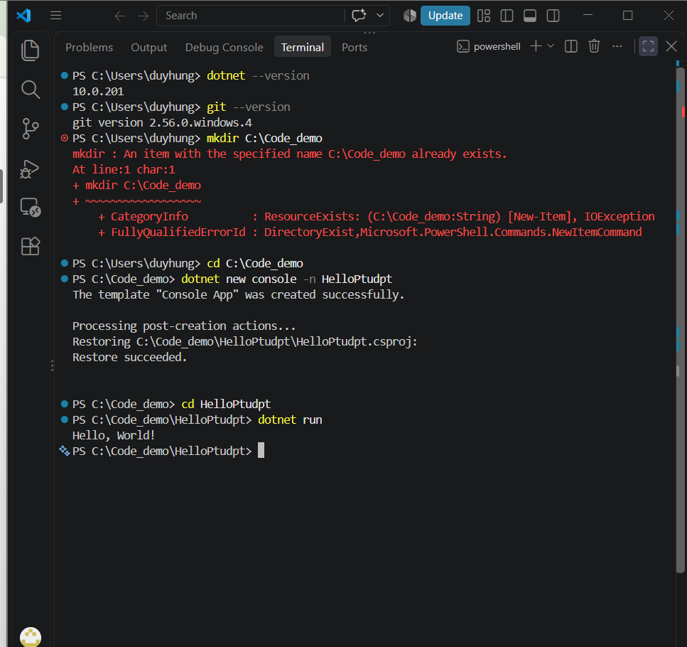
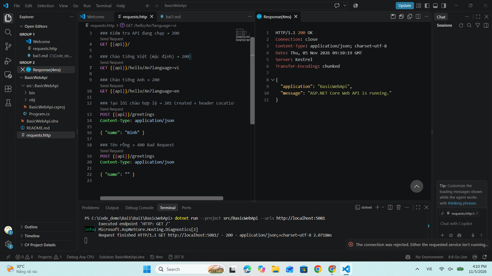
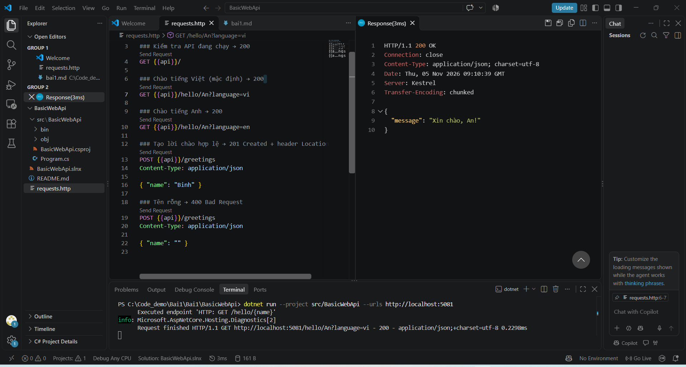
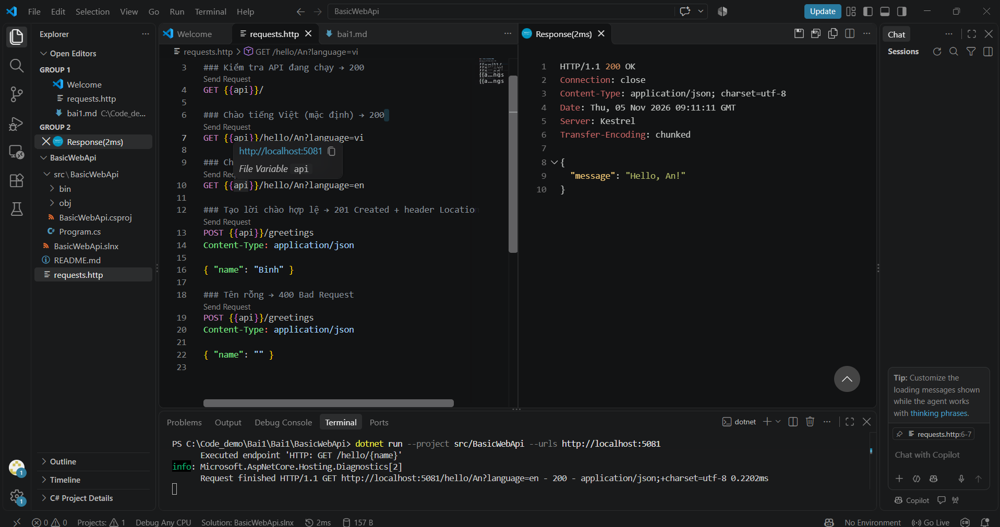
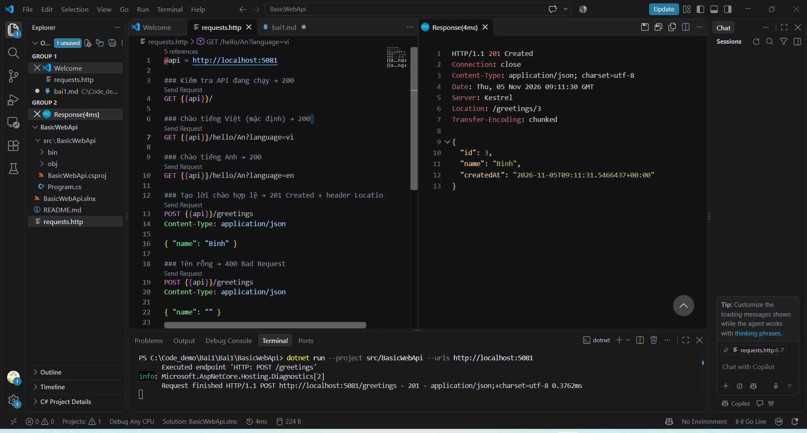
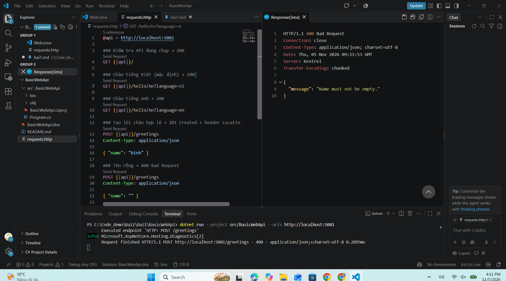
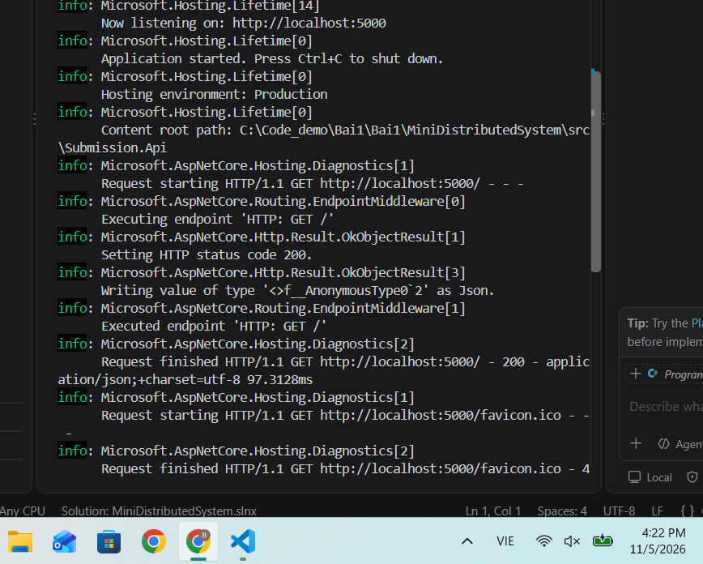
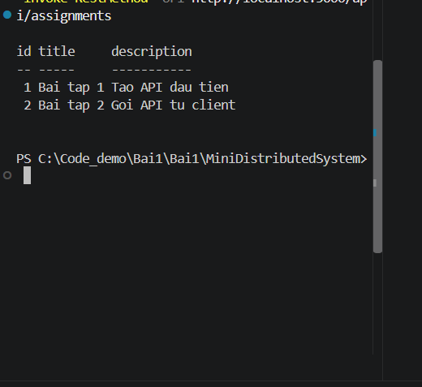

# Bài 1 – Tổng quan hệ thống và MEP

Họ tên:Bùi Duy Hưng MSSV:DTC245200362 Lớp:CNTT-K23C

## 1. Cài đặt

(ảnh chụp kết quả Bước 4)

do em làm trước rồi nên lúc chạy lại lệnh nó lỗi như vậy 
## 2. MepDemo (Bước 7)

câu 1 
Ở MEP 3, mỗi bài nộp sub-x được 1 worker xử lý
câu 2 
Ở MEP 4, một sự kiện được gửi tới 4 dịch vụ
câu 3 
MEP 1: Gửi yêu cầu đi và chờ nhận lại phản hồi.   MEP 3: Đẩy các công việc (job) vào hàng đợi để các worker xử lý dần.
MEP 4: Phát ra 1 sự kiện để truyền tới nhiều bên đã đăng ký nhận
## 3. BasicWebApi (Bước 8)

- Ảnh chụp REST Client: 200, 201, 400

- Trả lời 3 câu hỏi mục 8.4
1. Dòng builder.Services.AddSingleton<GreetingService>(); phải đứng trước. Quá trình đăng ký các dịch vụ (Dependency Injection container) phải được hoàn tất trước khi gọi builder.Build(). Lệnh Build() sẽ khởi tạo ứng dụng và "khóa" vùng chứa dịch vụ, vì vậy không thể đăng ký thêm dịch vụ mới sau khi ứng dụng đã được build.

2. URL, định nghĩa qua {name}, còn tham số language được lấy từ query string (phần tham số truy vấn nằm sau dấu ? trong URL).

3. Trong chuẩn thiết kế RESTful API, phương thức POST thường dùng để tạo mới một tài nguyên (ở đây là một đối tượng greeting mới). Trạng thái HTTP 201 (Created) là mã phản hồi chuẩn xác nhất cho hành động này, đồng thời nó cho phép đính kèm URL trỏ tới tài nguyên vừa được tạo mới trong Header Location (ví dụ: /greetings/{id}). Mã 200 (OK) chỉ mang ý nghĩa tác vụ thành công chung

## 4. MiniDistributedSystem (Bước 9)

- Ảnh chụp 2 terminal API + Client

- Trả lời 3 câu hỏi
Các endpoint Client gọi và thông tin Request–Response
Trong hệ thống Submission, Client thường gọi các endpoint chính sau:

Lấy danh sách bài tập:

Method: GET

URL: http://localhost:5000/api/assignments

Mã trạng thái (Status Code): 200 OK

Nộp bài làm:

Method: POST

URL: http://localhost:5000/api/submissions

Mã trạng thái (Status Code): 201 Created (hoặc 202 Accepted nếu xử lý hàng đợi bất đồng bộ)

Lấy kết quả/trạng thái bài nộp:

Method: GET

URL: http://localhost:5000/api/submissions/{id}

Mã trạng thái (Status Code): 200 OK

2. Tham chiếu mã nguồn và cơ chế giao tiếp giữa Client và API

Client KHÔNG tham chiếu (dùng chung) code của API: Submission.Client và Submission.Api là hai ứng dụng/tiến trình (process) chạy hoàn toàn độc lập, không thêm dependency hay project reference trực tiếp vào nhau.

Hai bên "thống nhất" với nhau bằng Hợp đồng API (API Contract):

Thống nhất về Giao thức giao tiếp: HTTP / HTTPS.

Thống nhất về Định dạng dữ liệu: JSON.

Thống nhất về Cấu trúc dữ liệu (Request/Response DTOs): Tên trường, kiểu dữ liệu, HTTP Method, đường dẫn URL (Route) và các mã trạng thái HTTP chuẩn.

3. Lý do truyền địa chỉ API qua tham số -- http://localhost:5000

Linh hoạt theo môi trường (Configurability): Địa chỉ server/cổng (port) có thể thay đổi khi chạy ở các môi trường khác nhau (Development, Staging, Production, Docker container,...). Việc truyền qua tham số truyền vào (hoặc file cấu hình appsettings.json) giúp thay đổi địa chỉ linh hoạt mà không cần sửa mã nguồn và biên dịch (recompile) lại ứng dụng.

Tuân thủ nguyên tắc thiết kế (Clean Code / 12-Factor App): Tách biệt hoàn toàn giữa cấu hình (Configuration) và mã nguồn (Code), giúp ứng dụng dễ bảo trì và mở rộng.

## 5. Thí nghiệm lỗi (Bước 10)

| # | Dự đoán | Thực tế | Đúng/Sai | Giải thích |
a. Thêm bài tập thứ 3 vào APIClient có cần sửa code không? Không.Vì sao: Client và API giao tiếp độc lập thông qua hợp đồng dữ liệu JSON (API Contract). Client đọc động mảng danh sách bài tập từ phản hồi GET /api/assignments. Khi API thêm bài tập thứ 3 vào danh sách trả về, Client sẽ tự động nhận và hiển thị bài tập mới mà không cần thay đổi hay biên dịch lại mã nguồn.
b. Tắt API rồi chạy ClientLỗi gặp phải: Lỗi ngoại lệ HttpRequestException (với lỗi con bên trong là SocketException: No connection could be made because the target machine actively refused it).Vì sao gọi qua mạng thất bại, còn gọi hàm cùng chương trình thì không?Gọi qua mạng (Distributed/Network): Phụ thuộc vào một tiến trình (process) máy chủ độc lập và hạ tầng mạng. Khi tắt API, không còn tiến trình nào lắng nghe (listen) ở cổng 5000, khiến việc bắt tay kết nối TCP/Socket thất bại.Gọi hàm trong cùng chương trình (In-process): Xảy ra ngay trong cùng một không gian bộ nhớ (Address Space) của một tiến trình. CPU chuyển trực tiếp con trỏ lệnh tới địa chỉ bộ nhớ chứa hàm, không phụ thuộc vào kết nối mạng hay tiến trình khác.
c. Đổi StudentCode thành chuỗi rỗng ""Mã trạng thái trả về: 400 Bad Request.   Tác dụng của EnsureSuccessStatusCode(): Lệnh này kiểm tra mã trạng thái HTTP nhận được từ API. Nếu mã không nằm trong dải thành công ($200 - 299$), nó sẽ lập tức ném ra ngoại lệ HttpRequestException để dừng luồng xử lý tiếp theo của Client.Vì sao máy chủ phải tự kiểm tra dữ liệu? Tuân thủ nguyên tắc an ninh "Không bao giờ tin tưởng dữ liệu từ Client" (Never trust client input). API là điểm tiếp nhận công khai, có thể bị gọi bởi các công cụ bên ngoài như curl, Postman hoặc kẻ tấn công (bỏ qua các bước kiểm tra giao diện). Việc máy chủ tự kiểm tra dữ liệu giúp bảo vệ tính toàn vẹn hệ thống và ngăn chặn dữ liệu rác lưu vào cơ sở dữ liệu.

## 6. Dự án EduSubmit tự làm (Bước 11-12)

- Ảnh chụp kết quả; phần nào phải xem code mẫu?

- Luồng thông điệp:

Client --(HTTP GET /api/assignments)--> Api : request-response

Client --(HTTP POST /api/submissions)--> Api : ...

## 7. Khó khăn gặp phải và cách giải quyết